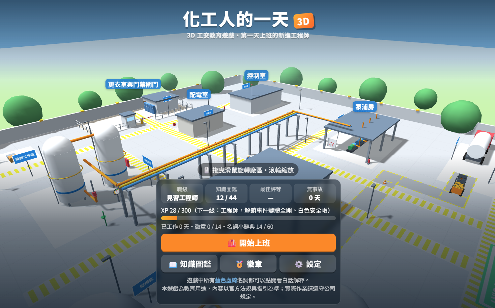
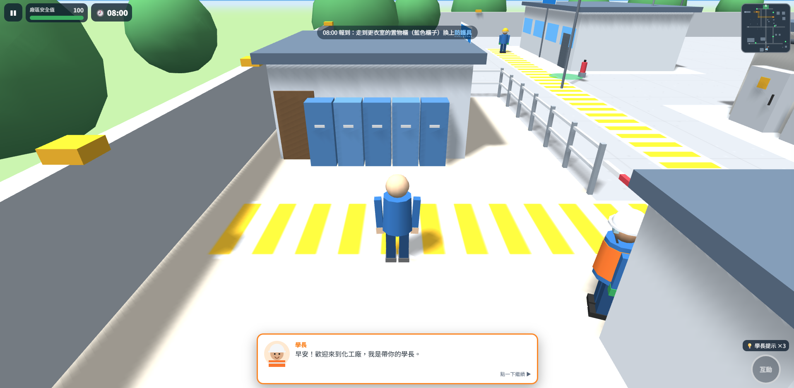
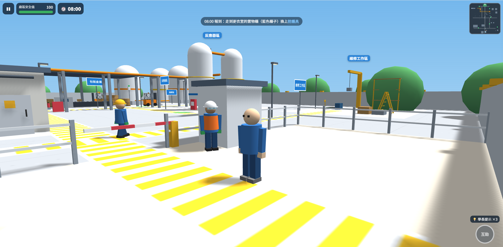
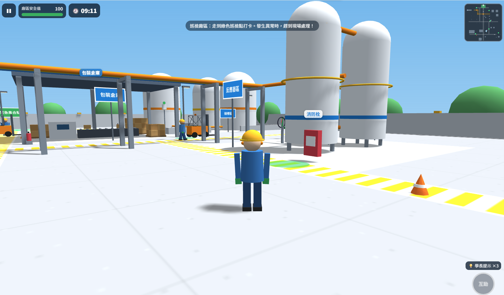
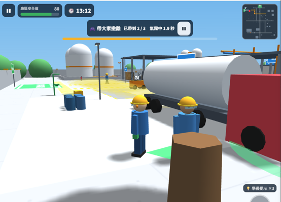
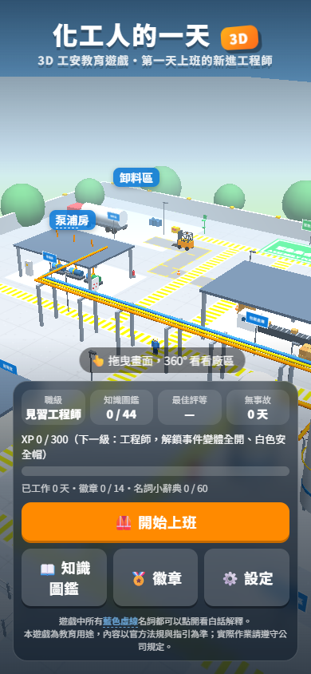
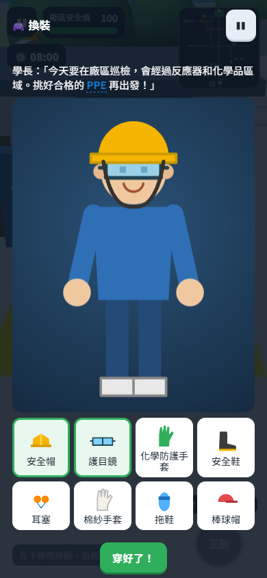
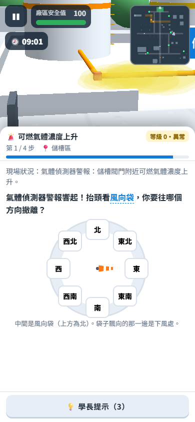
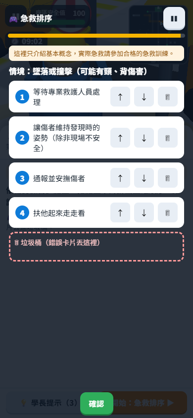

# 化工人的一天｜3D 工安教育遊戲

在瀏覽器裡玩的 3D 工安教育遊戲。你扮演第一天上班的新進工程師，從 08:00 報到到 17:00 下班，處理一整天隨機發生的突發事件，在安全的地方練習「做對的事」。

不需要任何化工背景，一局約 10 分鐘，電腦和手機都能玩。

**👉 線上試玩：** https://lcycool-ht.github.io/chem-day-safety/

---

## 畫面截圖

| 08:00 報到，學長帶你認識廠區 | 閘門前，學長檢查你的 PPE（個人防護具） |
| --- | --- |
|  |  |
| **巡檢反應器區與包裝倉庫** | **可燃氣體外洩，帶大家撤離到上風處** |
|  |  |

**手機直式畫面**

| 封面 | 換裝小遊戲 | 可燃氣體撤離事件 | 急救排序小遊戲 |
| --- | --- | --- | --- |
|  |  |  |  |

## 遊戲特色

- **一天的流程**：更衣室穿戴 PPE → 閘門檢查 → 工具箱會議（今天的風向）→ 巡檢 6 個點（每處多花 30 分鐘，每 1–2 處觸發一次突發事件）→ 午休 → 17:00 下班；沒做完可以選擇加班，或請晚班學長幫忙 → 今日工作報告
- **9 類突發事件**，每天隨機抽 4–6 類，地點與變體也隨機：
  管線壓力異常、可燃氣體外洩、泵浦異常震動、化學品洩漏、PPE 未正確穿戴、人員受傷、火災與悶燒、設備老化、承攬商作業
- **動手做，不只選答案**：每個事件都有小遊戲，例如轉閥門穩住壓力、畫線圍堵漏液、上鎖掛牌、拉瞄壓掃滅火、叫叫壓電（CPR）、熱像巡檢、許可證對照
- **失敗是學習**：答錯會讓事件惡化，到第 3 級成為事故，會出現「事故調查報告」說明原因與正確做法，可以選擇時光回溯重來。全程不出現血腥或傷亡畫面
- **名詞一點就懂**：遊戲中藍色虛線的專有名詞（例如 LEL、SDS、LOTO）都能點開，看一句白話解釋
- **想再玩一局**：星數評等、S/A/B/C 當日評等、4 個職級、44 張知識卡圖鑑、14 個徽章；職級升高會解鎖夜班模式與一日 6 事件挑戰

## 怎麼玩

| 動作 | 電腦 | 手機 |
| --- | --- | --- |
| 移動 | WASD 或方向鍵（按住 Shift 跑步） | 左下方拖曳（虛擬搖桿） |
| 轉視角 | 滑鼠拖曳 | 右半邊螢幕拖曳 |
| 縮放 | 滑鼠滾輪 | 雙指捏合 |
| 互動 | E 或空白鍵 | 右下角「互動」按鈕 |
| 地圖 | M | 點右上角小地圖 |
| 暫停 | Esc | 左上角暫停鍵 |

手機橫放體驗較好，直式也能玩。

## 執行方式

整個遊戲只有一個檔案：`index.html`。

- **直接開啟**：雙擊 `index.html`，用瀏覽器開啟即可，不需要架伺服器
- **放上 GitHub Pages**：把 `index.html` 放在 repository 根目錄，到 **Settings → Pages**，Source 選 `main` 分支的 `/ (root)`，存檔後等一兩分鐘就會產生網址

> 需要網路連線：遊戲會從 CDN 載入 Three.js。如果畫面停在「請確認網路連線後重新整理」，請檢查網路。

支援近兩年的 Chrome、Edge、Firefox、Safari（iOS 15 以上）。

## 技術說明

- **3D 引擎**：[Three.js](https://threejs.org/) r128（cdnjs CDN）
- 模型、貼圖、音效全部以程式產生：低多邊形幾何體、Canvas 2D 貼圖、Web Audio API 合成音效，沒有任何外部素材檔
- 不使用任何 UI 框架或建置工具，HTML / CSS / JavaScript 全部寫在同一個檔案
- 進度存在瀏覽器的 `localStorage`（key：`chemDay_save_v1`），清除瀏覽器資料就會重新開始；可在「設定」中重置存檔
- 事件內容採資料驅動：新增事件只要在 `EVENTS` 加一筆資料

### 除錯模式

網址後面加 `?debug=1`（例如 `index.html?debug=1`）會顯示 FPS，並可使用：

- 數字鍵 `1`–`9`：直接觸發對應事件
- `F`：時鐘快轉 30 分鐘
- `T`：跳到下班時間
- `G`：跳過開場換裝

## 內容說明與免責聲明

- 本遊戲為**教育用途**，用來建立基本工安觀念，不能取代正式的安全衛生教育訓練
- 急救內容只介紹基本概念，**實際急救請參加合格的急救訓練**
- 工安、消防、急救與法規內容參考職業安全衛生法、職業安全衛生設施規則、內政部消防署與衛生福利部等官方資料，以及 AHA／美國紅十字會指引（2026 年 10 月查證）。法規可能修正，實際作業請以最新法規與公司規定為準
- 遊戲中的廠區、人物與案例皆為虛構或已去識別化

## 製作

本專案依《化工人的一天｜3D 工安教育遊戲規格書》，使用 Claude Code 協助生成，為生成式 AI 課程作業。
